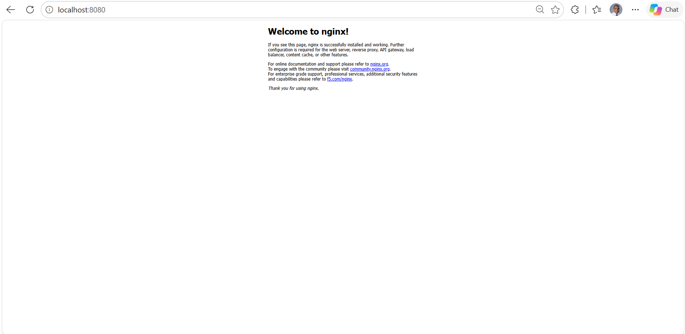
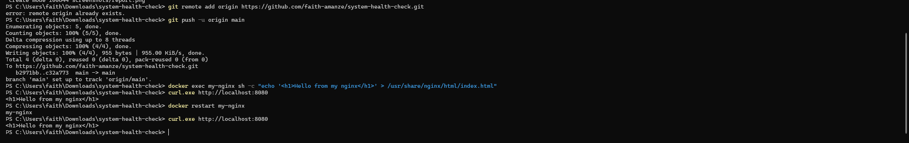
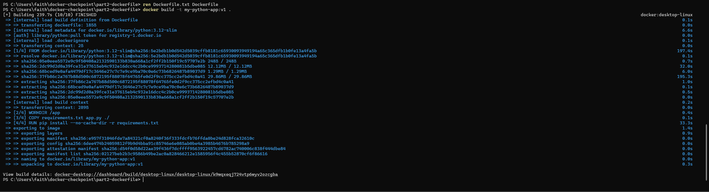
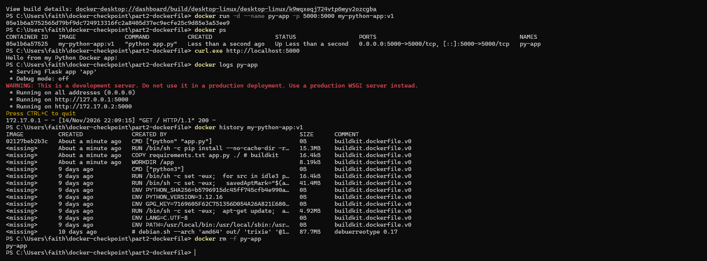
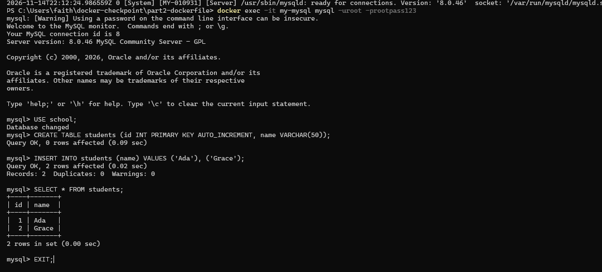
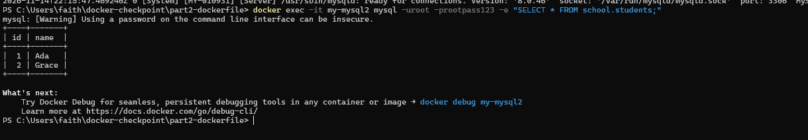
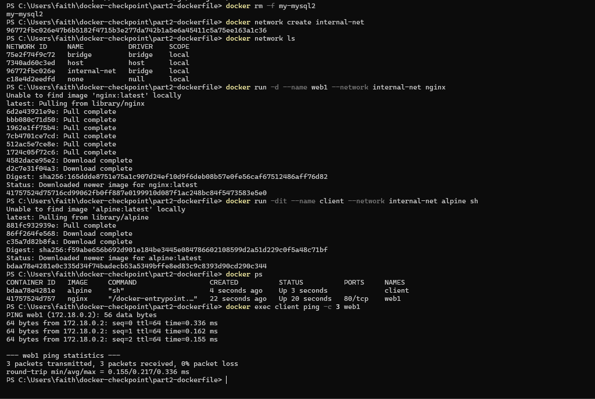
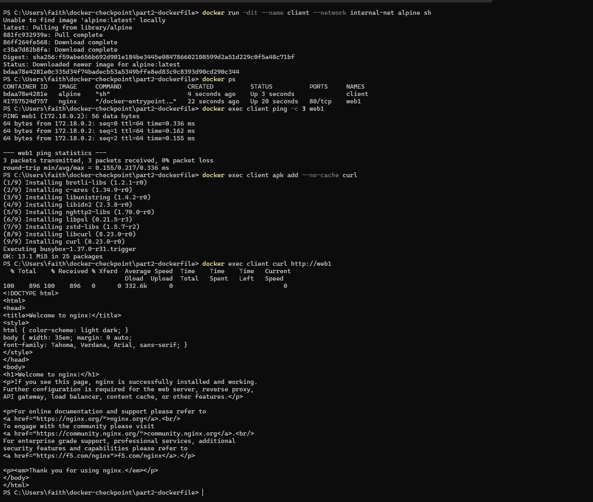

# Docker Checkpoint

Hands-on Docker work covering the CLI, Dockerfiles, volumes, networking and Docker Compose.
Tested on Windows 11, Docker Desktop, PowerShell 5.1.

## Image sources

| Image | Source |
|---|---|
| nginx, nginx:1.27-alpine, python:3.12-slim, mysql:8.0, alpine | Docker Hub official images (https://hub.docker.com) |
| my-python-app:v1 | Built locally from part2-dockerfile/Dockerfile |
| part5-compose-backend | Built locally by Docker Compose from part5-compose/backend/Dockerfile |

## Repo layout

- part2-dockerfile/ : Dockerfile, app.py, requirements.txt
- part5-compose/ : docker-compose.yml, .env, backend/ (Flask app + Dockerfile), nginx/nginx.conf
- screenshots/ : proof for each part

## Part 1: Docker basics

    docker pull nginx
    docker run -d --name my-nginx -p 8080:80 nginx
    docker exec -it my-nginx bash
    ls /usr/share/nginx/html
    exit
    docker exec my-nginx sh -c "echo '<h1>Hello from my nginx</h1>' > /usr/share/nginx/html/index.html"
    curl.exe http://localhost:8080
    docker restart my-nginx
    curl.exe http://localhost:8080
    docker stop my-nginx
    docker rm my-nginx
    docker rmi nginx

## Part 2: Dockerfile and image

    cd part2-dockerfile
    docker build -t my-python-app:v1 .
    docker run -d --name py-app -p 5000:5000 my-python-app:v1
    curl.exe http://localhost:5000
    docker history my-python-app:v1
    docker rm -f py-app

## Part 3: Volumes (MySQL)

    docker volume create mysql-data
    docker run -d --name my-mysql -e MYSQL_ROOT_PASSWORD=rootpass123 -e MYSQL_DATABASE=school -v mysql-data:/var/lib/mysql mysql:8.0
    docker exec -it my-mysql mysql -uroot -prootpass123

Inside MySQL:

    USE school;
    CREATE TABLE students (id INT PRIMARY KEY AUTO_INCREMENT, name VARCHAR(50));
    INSERT INTO students (name) VALUES ('Ada'), ('Grace');
    SELECT * FROM students;
    EXIT;

Remove the container, then start a new one on the same volume:

    docker stop my-mysql
    docker rm my-mysql
    docker run -d --name my-mysql2 -e MYSQL_ROOT_PASSWORD=rootpass123 -v mysql-data:/var/lib/mysql mysql:8.0
    docker exec -it my-mysql2 mysql -uroot -prootpass123 -e "SELECT * FROM school.students;"
    docker rm -f my-mysql2

The data persisted. The password is a throwaway demo value for local testing only.

## Part 4: Networking

    docker network create internal-net
    docker run -d --name web1 --network internal-net nginx
    docker run -dit --name client --network internal-net alpine sh
    docker exec client ping -c 3 web1
    docker exec client apk add --no-cache curl
    docker exec client curl http://web1
    docker rm -f web1 client
    docker network rm internal-net

## Part 5: Docker Compose (Flask + Nginx)

Environment variable (part5-compose/.env):

    APP_MESSAGE=Hello from Docker Compose

R
